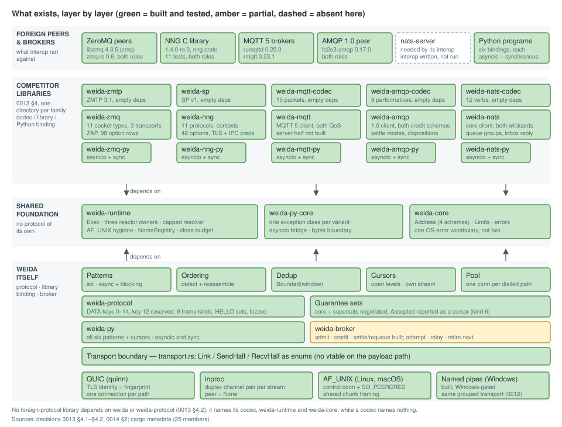
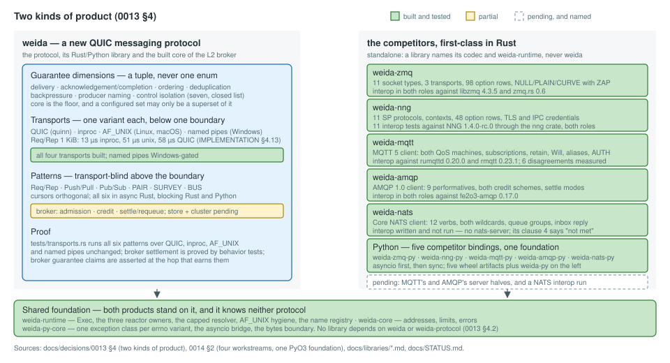
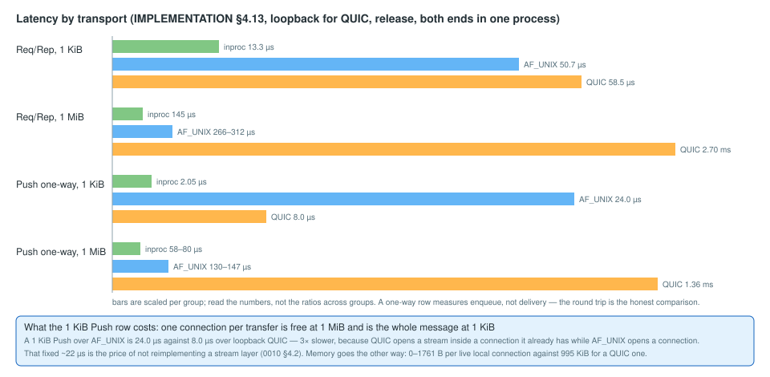

# Status

A one-page picture of what weida is: the layers that exist, the two product lines, the
measurements that decided something, what comes next and what needs a human. It carries no
commit, no test count and no date, so it stays true until the picture itself changes.
[IMPLEMENTATION.md](IMPLEMENTATION.md) is the source of truth for every phase and measurement;
[BACKLOG.md](BACKLOG.md) and [NIGHTLOG.md](NIGHTLOG.md) are the loop's own record. The diagrams
live in `docs/status/` and are plain SVG; regenerate them by hand when the picture changes.

## 1. What exists, layer by layer

The load-bearing line is the **transport boundary**: `Link`, `SendHalf` and `RecvHalf`, enums in
`crates/weida/src/transport.rs`. Everything above it is transport-blind, and
`tests/transports.rs` runs all six patterns over QUIC, inproc, `AF_UNIX` and, on Windows, named
pipes. Below it the two kernel-mediated transports share one implementation of the 0012
grouping and the same per-write chunk framing, generic over what a socket and a pipe differ in;
that shared framing is what makes an interrupted `AF_UNIX` stream distinguishable from a FIN.

The **reactor is its own crate**: `weida-runtime` holds `Exec`, the three reactor-ownership
constructors, the capped resolver, the `AF_UNIX` and named-pipe hygiene and the name registry.
It depends on `weida-core`, `tokio` and, on Windows only, `weida-winpipe`, the one crate in the
tree that may use `unsafe`. That is what lets a ZeroMQ user open a socket without linking quinn,
rustls and weida's pattern layer. Above it the tree is **one directory per protocol family**
(`crates/zmq/`, `crates/nng/`, `crates/mqtt/`, `crates/amqp/`, `crates/nats/`, `crates/http/`), so the
directory list answers "does this repository ship a ZeroMQ?". Each codec crate has an **empty
`[dependencies]`** section, so it can be checked against its RFC rather than against our
reading of it; each library depends on its codec, the runtime and `weida-core`, and never on
`weida`. The unbounded-allocation invariant covers the foreign-protocol crates too, and every
bound they add is named where it is taken ([INVARIANTS.md](INVARIANTS.md)).

**Completions are cursors, on a stream of their own.** `weida::Cursors`, `weida::CursorSet` and
`weida::Reporter` are the acknowledgement surface of
[0023](decisions/0023-completion-is-a-cursor.md) and
[0024](decisions/0024-three-families-one-back-channel.md): a sender orders levels per transfer
with `TransferMeta::with_report` and reads absolute byte offsets back on frame kind `6`, a
unidirectional stream that never shares a stream with payload. Two properties are structural
rather than promised. **No pattern's topology changes**: a Push transfer that orders cursors is
still one unidirectional stream, proved against a raw `quinn` peer because the library's own API
cannot assert it. And **nothing waits on a cursor**: a sender that never reads its cursors blocks
no transfer, a receiver that never reports fails none, and the level space is open — `0..=15` is
weida's ladder, `16` and above is the application's, carried and ordered but never interpreted.
`weida-broker` is the first user: a Push producer that orders `Accepted` gets it at the admitted
body length on **one unidirectional stream**, with no exchange and no reply half, while an
exchange's publisher confirm stays the DATA key `8` reply. A level the broker cannot reach —
`Stored`, with no store — is absent from the report rather than failed, which is
[GUARANTEES.md](GUARANTEES.md) §1's prohibition seen from the reporting side.

**A synchronous wait always has a deadline.** The blocking `Cursors::changed(deadline)` takes a
mandatory one for the reason [0009](decisions/0009-drain.md) §4.4 gives: a peer that never
reports opens no stream, a report that never starts never ends, and a connection both sides keep
alive never closes, so a parked thread would wait forever. The library's
`Cursors::changed_within(deadline)` answers `Reported::{Changed, Waiting, Ended}` — three
outcomes, because a deadline is not an ending — and `weida.sync.Cursors.changed(seconds)`
raises `TimeoutError`.

**The broker owns a delivery until somebody reports it processed.** `weida-broker` admits and
confirms at `Accepted`, registers ordinary subscribers and delivers under their cumulative
credit, and moves each delivery into an `unsettled` table **without releasing its `queue_bytes`
charge**. The consumer's `Processed` cursor settles it, while a report that ends without one
requeues it at the head. `max_unsettled` is a live per-subscription bound, not a clamp on
lifetime credit. What is not built is kept separate and named: the attempt count on DATA key
`12`, relaying a consumer report toward the producer under the producer's report id, and
`retire(deadline)`.

**The pattern family is complete.** Req/Rep, Push/Pull and Pub/Sub, with PAIR, SURVEY and BUS,
close [ARCHITECTURE.md](ARCHITECTURE.md) §6b's table and with it the nanomsg set — and the last
three cost **no wire vocabulary at all**: a `weida::Paired` talks to a bare `Peer` and
`Acceptor` on the same path, a `Respondent`'s route is byte-for-byte a replier's, a
`BusMember`'s is a puller's. Each needed exactly one thing the mapping had not seen, and each is
where a hand-built version goes wrong: PAIR refuses a second peer with `LIMIT_EXCEEDED` and
**keeps the first**, a survey counts a late reply where it arrives rather than where the caller
reads, and a bus needs a writer per member — without one a single member that stops reading
blocks the sender.

**Late is lost has a vocabulary** ([decisions/0034](decisions/0034-late-is-lost.md)). A datagram
flow is L0's third carrier; `expire_at` and `set_priority` stop a stream on time; RADIO/DISH
fans segments out with supersession and per-dish expiry. Of the patterns it is the one that
adds wire vocabulary — DATA keys `13` and `14` for the segment and its layer, SUBSCRIBE keys `2`
and `3` for the dish's latency budget and layer cap, and the FLOW frame kind — while PAIR,
SURVEY and BUS add none.

**A blob from many holders is a pattern, not a system.** SWARM ([decisions/0040](decisions/0040-swarm-pattern.md),
[decisions/0041](decisions/0041-swarm-sessions.md)) is behind the off-by-default feature
`swarm`. `Listener::seeder` binds the holder's side and hands each fetch's session to the
application, which admits it once and answers its orders from its own storage; `Runtime::swarm`
dials every seeder it is given, and `Swarm::fetch` takes one content-addressed blob from all of
them at once, checking each piece against the BLAKE3 root before it yields it. The root is the
plain `blake3::hash` of the bytes, so the pieces come in any order from any holder and a lying
seeder is dropped for that fetch while the blob completes. One session per seeder carries
pipelined orders, as deep as libtorrent sizes them and capped by a credit that the caller's
taking of pieces releases, so one fetch from one seeder runs like a normal download and a
caller that stops taking stops the sender. It adds **no wire vocabulary** (one exchange per
session on the request route, like SURVEY; version-1 asks still served), and it keeps no store
and no tracker: the application stores the pieces it is handed and decides who to connect to.

**Tests need no network.** `RuntimeConfig::network` picks where a runtime's QUIC sockets live:
the operating system's UDP, or, behind the off-by-default feature `test-util`, a `SimNet`
([decisions/0042](decisions/0042-simulated-network.md)): an in-memory UDP network that the
unmodified QUIC and TLS stacks run over. Fixture code stays what it is over loopback
(`bind_quic`, a pinned `weida://fp@127.0.0.1:port/..` URL), so identities, mTLS refusals,
redials and their `PeerEvent`s are the real ones. Per-port delay, drop and partition faults
stand in for a slow path, packet loss and an unannounced disconnect. Every wait weida measures
is on the runtime's clock (`Exec::now`), so a test under `start_paused` spends paused minutes
of idle timeout and backoff in milliseconds of wall time.

**A small message is mostly payload.** A trace context is propagated and never minted
([0028](decisions/0028-trace-propagation-is-the-callers.md)), so a 64-byte push is twelve bytes
of framing and weida is in ZMTP's and SP's class on small messages
([IMPLEMENTATION.md](IMPLEMENTATION.md) §4.5).

**There is a guide that teaches.** [GUIDE.md](GUIDE.md) is organised around one question —
**C8B: how do you scale a software system to eight billion people?**, this project's C10K,
utopian on purpose — and every program in it is a file in the tree that a test drives
([0026](decisions/0026-the-guide-and-the-c8b-question.md)).

## 2. The product line

The two halves of that picture are the two products of
[0013](decisions/0013-competitor-libraries.md) §4: weida on the left, with the guarantee
dimensions, transports and patterns it offers, and the six standalone foreign-protocol
libraries on the right. They share runtime foundations but no implicit semantic conversion.

weida itself ships a library with an async API and, behind the non-default `blocking` feature,
a synchronous one (`weida::blocking`), the `weida` binary and a Python binding. Each of the six
libraries — ZeroMQ, nanomsg SP, MQTT 5, AMQP 1.0, Core NATS and HTTP — has a parity document in
[libraries/](libraries/README.md) and, where a peer exists to measure against, an interop
suite; the NATS suite is written and not run, which its parity table records as a clause **not
met** rather than rounding up. HTTP speaks HTTP/1.1, HTTP/2 and HTTP/3 in both roles, and
`weida-openbao` uses it in place of `reqwest`. There are **six Python bindings**: the first five
libraries plus `weida-py`, each with an asyncio and a synchronous surface on the shared
`weida-py-core` foundation, and `weida-py` is the one that reaches every weida pattern and its
cursor surface; HTTP's binding is filed (B-371).

## 3. The measurements that decided something

Each row is a measurement whose number settled a design question. The commands, the
environment and the full results are in [IMPLEMENTATION.md](IMPLEMENTATION.md) §4.

| Question | Number | Source | What it decided |
| --- | --- | --- | --- |
| Two extra DATA keys per message | +80 B, −9 % msg/s | [IMPLEMENTATION.md](IMPLEMENTATION.md) §4.4 | producer identity travels as a 32-byte `bstr`, not hex (0008 §4.4) |
| Reorder buffer under reverse completion | peak N − 1; 84 of 256 unforced | [IMPLEMENTATION.md](IMPLEMENTATION.md) §4.7 | `max_reorder_hold` is a configured number, default 256 |
| Second connection per peer | 1.05 ms handshake, ~1 MiB per pair | [IMPLEMENTATION.md](IMPLEMENTATION.md) §4.8, §4.9 | one connection per dialled path is affordable (0002, 0011) |
| Segment matcher in the fan-out path | 14 ns per filter, shape-independent | [IMPLEMENTATION.md](IMPLEMENTATION.md) §4.10 | the grammar is not the cost; registry iteration is |
| Parking a drain receipt on drop | a runtime-wide queue −3 %, per-connection inside noise | [IMPLEMENTATION.md](IMPLEMENTATION.md) §4.6 | per-connection parking; the claim is one uncontended lock and a push, not "free" |
| Dedup key allocation | ~10 ns; the candidate restructuring measures the same | [IMPLEMENTATION.md](IMPLEMENTATION.md) §4.12 | key left alone, with the number beside it |
| Local transports against QUIC | Req/Rep 1 KiB 13 µs inproc, 51 µs unix, 58 µs QUIC; Push 1 KiB 24 µs unix against 8 µs QUIC | [IMPLEMENTATION.md](IMPLEMENTATION.md) §4.13 | a local `open` waits for a slot, and 0010 §4.2's "the connection is the stream" is priced: free at 1 MiB, the whole cost at 1 KiB |
| One SWARM fetch from one seeder, 26 ms RTT | session 50.8-55.3 MB/s against 44.8-45.8 MB/s for a plain download on the same path; 683 MiB/s on loopback | [IMPLEMENTATION.md](IMPLEMENTATION.md) §4.18 | one session of pipelined orders per seeder replaces one exchange per ask (0041), which griasdi measured at 4-10 MB/s |

More measurements shape a decision outside the table: the Python boundary and round trip
([IMPLEMENTATION.md](IMPLEMENTATION.md) §4.14, §4.15) keep the binding's copies and answer "no"
to a second Python client for PyPy, because the cost is one event-loop wakeup per `await`; the
fan-out at width ([IMPLEMENTATION.md](IMPLEMENTATION.md) §4.11) shows the delivery rate, not
memory, bounding a node; and voice beside bulk ([IMPLEMENTATION.md](IMPLEMENTATION.md) §4.17)
puts a bulk profile that shares a bottleneck with media on `Congestion::Bbr`
([0034](decisions/0034-late-is-lost.md) §6).

## 4. What comes next

The ready items of [BACKLOG.md](BACKLOG.md) fall into these themes:

- **Finishing the broker's outcome half.** The redelivery count on the wire (DATA key `12`), so
  that a consumer can tell a redelivery from a first delivery; relaying a consumer's report to
  the producer under the producer's report id; and `retire(deadline)`, a queue's drain, which is
  not the transport's.
- **The cluster's edge.** The trust set a redirect may be followed inside, the not-the-leader
  answer with a bound on following it, the bounds a cluster adds with the failure each
  prevents, and an SRV resolver as a convenience over the `Resolver` seam.
- **The guide.** Chapter 5, a peer that comes back: what a redial restores and what it does
  not.

Behind them sit the phases of [IMPLEMENTATION.md](IMPLEMENTATION.md) §1 that are not built:
persistence, consensus-backed clustering, the Web binding, and the language bindings after
Python, whose order is Node, Erlang, C, Java
([0030](decisions/0030-which-runtimes-and-in-which-order.md)).

What is **not** a follow-up: SWARM's edges are the application's by decision. A tracker or
announcer, a blob store, one identity per connection and following a Raft leader stay out of
weida ([0040](decisions/0040-swarm-pattern.md) §6), and mirrors of SWARM in `weida::blocking`
and Python are filed when a caller needs them. griasdi moves its seeder onto sessions on its
side (`PROPOSAL-weida-swarm-sessions.md` in its checkout).

## 5. What needs a human

Questions that want the owner's eye are collected in [NIGHTLOG.md](NIGHTLOG.md) under "Review
needed". The decision notes below are still `provisional`: each was taken without a human and is
reversible ([decisions/README.md](decisions/README.md)), and each wants a yes or a change.

- [0016](decisions/0016-conflation.md): conflation — keep the newest, discard the rest; the
  producer holds the single slot and a fan-out coalescer is refused.
- [0017](decisions/0017-subscription-verdict.md): a per-subscription verdict — the silence
  stays, and is defined.
- [0018](decisions/0018-minimal-broker.md): what the minimal L2 broker is.
- [0019](decisions/0019-jvm-binding.md): how a JVM binding reaches these libraries.
- [0020](decisions/0020-cluster-and-discovery.md): a cluster is a set of nodes the client may
  know about.
- [0021](decisions/0021-consensus-openraft.md): consensus is a dependency, not a subsystem.
- [0022](decisions/0022-consensus-topology.md): consensus topology — one group for the cluster,
  one per replicated queue.
- [0023](decisions/0023-completion-is-a-cursor.md): a completion is a cursor, and wire state is
  not one.
- [0029](decisions/0029-a-report-is-relayed-a-certificate-is-not.md): a report is relayed, a
  certificate is not.
- [0030](decisions/0030-which-runtimes-and-in-which-order.md): which runtimes the language
  bindings reach, and in which order.
